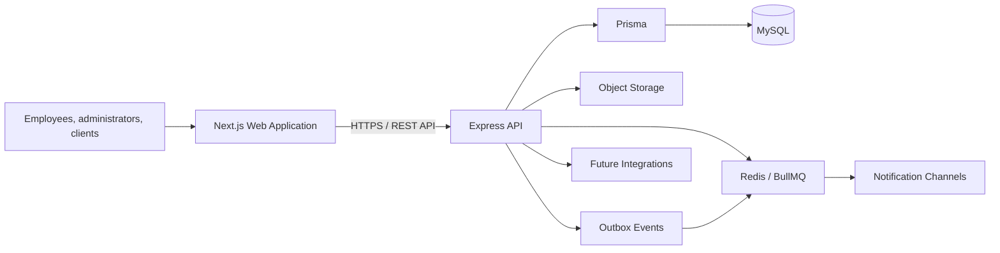
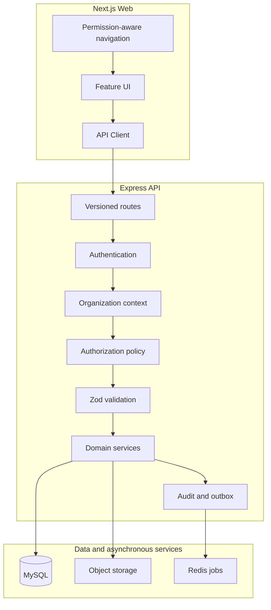
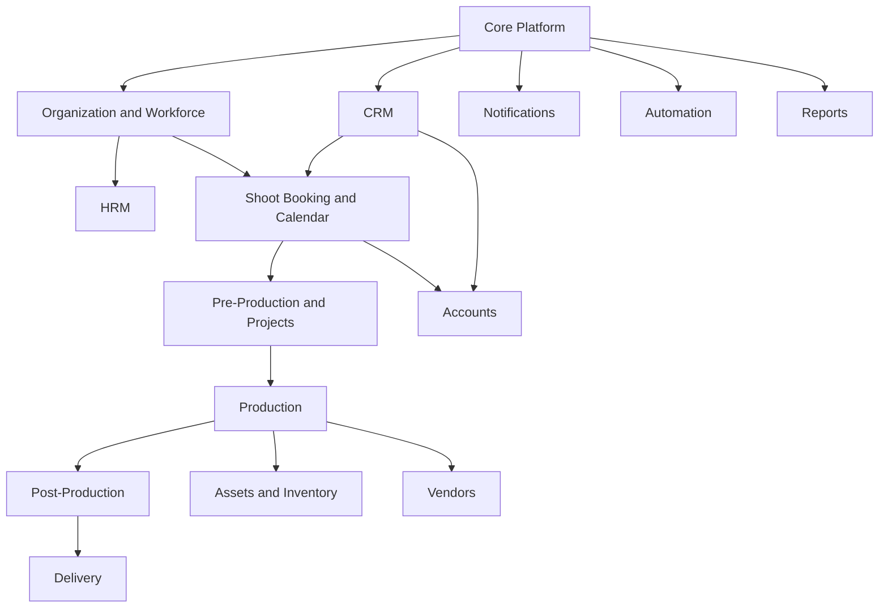
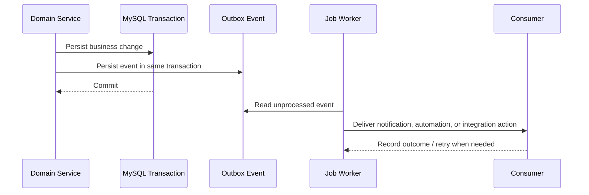

# DBS-Operations-OS ERP Architecture

## Table of Contents

- [Project Vision](#project-vision)
- [Project Goals](#project-goals)
- [Design Principles](#design-principles)
- [Technology Stack](#technology-stack)
- [High-Level Architecture](#high-level-architecture)
- [System Architecture](#system-architecture)
- [Module Architecture](#module-architecture)
- [Database Philosophy](#database-philosophy)
- [Shared Platform Services](#shared-platform-services)
- [Module Ownership Rules](#module-ownership-rules)
- [Authentication Architecture](#authentication-architecture)
- [Authorization Strategy](#authorization-strategy)
- [Event Architecture](#event-architecture)
- [Notification Architecture](#notification-architecture)
- [File Storage Strategy](#file-storage-strategy)
- [Folder Structure Philosophy](#folder-structure-philosophy)
- [Coding Principles](#coding-principles)
- [Future Integrations](#future-integrations)
- [Long-Term ERP Vision](#long-term-erp-vision)

## Project Vision

DBS-Operations-OS is the operational system of record for Don't Blink Studio. It is an ERP / Operations OS, not an HRM-only product. HRM is the first business module because employee identity, employment history, permissions, and availability are prerequisites for studio operations.

The long-term product manages the company lifecycle from lead acquisition through client delivery, financial control, reporting, and automation. Each module remains independently developable while using common platform services.

## Project Goals

- Establish one trusted source of operational data for Don't Blink Studio.
- Build reusable platform capabilities once: authentication, authorization, documents, notifications, audit logs, and settings.
- Treat Employee Management as the canonical workforce foundation for all employee-dependent workflows.
- Support the studio lifecycle: lead, client, booking, pre-production, production, post-production, delivery, and accounts.
- Preserve reliable historical records for operational, financial, and compliance reporting.
- Remain maintainable as the organization grows from a small team to hundreds of employees and concurrent productions.

## Design Principles

1. **Modular monolith first.** Deploy one application while enforcing strong internal module boundaries; do not introduce microservices before operational need exists.
2. **Shared services, owned domains.** Modules reuse platform services but own their own business rules and tables.
3. **Employee is canonical workforce identity.** A user account is optional and separate from an employee record.
4. **History is data.** Employment, assignment, status, financial, and approval changes are effective-dated or immutable where appropriate.
5. **Secure by default.** Backend authorization is mandatory; frontend permission checks are usability enhancements only.
6. **API contracts are stable.** All public application APIs are versioned and validated.
7. **Files are not database blobs.** Binary data belongs in object storage; MySQL stores metadata and relationships.
8. **Events follow committed data.** Notifications and automation react to reliable domain events after a successful transaction.
9. **Design for multi-organization readiness.** Organization scoping is explicit from the foundation onward.
10. **Prefer simple, measurable infrastructure.** Add queues, read models, and service extraction only when workloads require them.

## Technology Stack

| Layer | Approved technology |
|---|---|
| Frontend | Next.js 16, React 19, JavaScript initially, Tailwind CSS 4, shadcn/ui as the UI system |
| Backend | Node.js 24, Express 5 |
| ORM and migrations | Prisma 6 |
| Transactional database | MySQL |
| Authentication | JWT, bcryptjs, Express middleware |
| Validation | Zod |
| Authorization | CASL policy model, implemented across frontend and backend |
| Forms and server state | React Hook Form, TanStack Query, TanStack Table |
| Background processing | Redis and BullMQ when asynchronous work is introduced |
| Object storage | S3-compatible object storage for files and media |
| Logging and observability | Structured logging, OpenTelemetry-compatible tracing, Sentry |

## High-Level Architecture



## System Architecture

The frontend is a Next.js application responsible for presentation, navigation, server-state caching, forms, and permission-aware user experiences. The Express API owns authentication, authorization, validation, business logic, transactions, audit records, and external integrations. Prisma provides the database access and migration boundary.



## Module Architecture



### Core Platform

| Area | Architecture |
|---|---|
| Purpose | Provide shared identity, access, organization scope, audit, settings, events, and integration foundations. |
| Responsibilities | Authentication, users, roles, permissions, organization settings, audit logging, feature controls, integration credentials, reliable event publishing. |
| Major tables | `organizations`, `organization_settings`, `users`, `sessions`, `roles`, `permissions`, `role_permissions`, `user_roles`, `documents`, `document_links`, `audit_logs`, `feature_flags`, `integration_connections`, `outbox_events`. |
| Relationships | An organization owns users, roles, settings, documents, audit logs, integrations, and events. Roles receive permissions; users receive roles. Documents use controlled links to their business records. |
| Shared tables | All Core Platform tables are shared by every module through explicit organization and user references. |
| Future expansion | Multi-organization groups, SSO, API keys, external identity providers, tenant administration, compliance retention policies. |

### HRM

| Area | Architecture |
|---|---|
| Purpose | Maintain workforce identity, organizational placement, attendance, leave, and later payroll. |
| Responsibilities | Employee lifecycle, employee directory, departments, reporting lines, attendance, leave, policies, and payroll handoff. |
| Major tables | `departments`, `locations`, `designations`, `employment_types`, `employees`, `employee_profiles`, `employee_contacts`, `employee_employments`, `employee_assignments`, `employee_status_history`, employee-scoped `document_links`, attendance tables, leave tables, and later payroll tables. |
| Relationships | Employees have employment and effective-dated assignment history to departments, designations, locations, and managers. Attendance, leave, payroll, shoots, and projects reference `employeeId`. |
| Shared tables | `organizations`, `users`, `documents`, `audit_logs`, `notifications`, and `employees`. |
| Future expansion | Recruitment conversion, performance, learning, compensation, skills, equipment allocation, employee self-service. |

### CRM

| Area | Architecture |
|---|---|
| Purpose | Manage demand from lead acquisition to qualified opportunities and quotations. |
| Responsibilities | Leads, client accounts, contacts, sales activities, pipelines, opportunities, and quotations. |
| Major tables | `lead_sources`, `leads`, `lead_activities`, `clients`, `client_contacts`, `client_addresses`, `pipelines`, `pipeline_stages`, `opportunities`, `opportunity_activities`, `quotations`, `quotation_line_items`. |
| Relationships | Leads convert to clients; clients own contacts and opportunities; opportunities produce quotations. Confirmed quotations can create bookings. |
| Shared tables | `organizations`, `users`, `employees`, `documents`, `audit_logs`, `notifications`, and later `calendar_events`. |
| Future expansion | Marketing attribution, client portals, contracts, recurring clients, sales forecasts, customer support. |

### Shoot Booking

| Area | Architecture |
|---|---|
| Purpose | Convert accepted commercial work into scheduled studio and production operations. |
| Responsibilities | Service catalog, booking lifecycle, crew allocation, location reservations, calendar scheduling, rescheduling, and cancellation history. Asset-reservation workflows are activated with the Assets module. |
| Major tables | `service_catalog`, `service_packages`, `service_package_items`, `bookings`, `booking_line_items`, `booking_requirements`, `booking_status_history`, `booking_employee_assignments`, `booking_asset_reservations`, `booking_location_reservations`, `calendar_events`, `calendar_event_participants`. |
| Relationships | A client booking contains services, requirements, employee assignments, asset/location reservations, and calendar events. A booking may create projects. |
| Shared tables | `clients`, `employees`, `locations`, `assets`, `documents`, `notifications`, and `calendar_events`. |
| Future expansion | Capacity planning, availability rules, conflict detection, deposits, booking portals, recurring services. |

### Pre Production

| Area | Architecture |
|---|---|
| Purpose | Convert a booking into an executable creative and operational plan. |
| Responsibilities | Project setup, briefs, task planning, shot lists, moodboards, scripts, call sheets, checklists, and project team allocation. |
| Major tables | `projects`, `project_members`, `project_status_history`, `project_tasks`, `task_assignees`, `task_dependencies`, `project_briefs`, `shot_lists`, `shot_list_items`, `moodboards`, `scripts`, `call_sheets`, `call_sheet_entries`, `project_checklists`. |
| Relationships | Projects derive from bookings and contain members, tasks, planning artifacts, call sheets, and checklists. |
| Shared tables | `bookings`, `employees`, `clients`, `vendors`, `locations`, `documents`, `calendar_events`, and `notifications`. |
| Future expansion | Template projects, resource planning, budget baselines, external collaborator access, approval gates. |

### Production

| Area | Architecture |
|---|---|
| Purpose | Record and coordinate shoot-day execution. |
| Responsibilities | Production days, crew call times, location details, equipment checkout, incidents, changes, and capture batches. |
| Major tables | `production_days`, `production_day_assignments`, `production_locations`, `production_equipment_checkouts`, `production_notes`, `production_incidents`, `capture_batches`. |
| Relationships | A project owns production days; each day has employee assignments, locations, assets, incidents, and capture batches. |
| Shared tables | `projects`, `employees`, `assets`, `vendors`, `locations`, `documents`, `notifications`, and audit records. |
| Future expansion | Mobile shoot-day workflows, GPS check-in, safety compliance, production costing, offline capture. |

### Post Production

| Area | Architecture |
|---|---|
| Purpose | Manage creative media ingestion, editing, versioning, review, and approval workflows. |
| Responsibilities | Media asset lifecycle, edit-job allocation, internal/client review, render tracking, archival, and approved output versions. |
| Major tables | `media_assets`, `media_asset_versions`, `media_collections`, `media_collection_items`, `edit_jobs`, `review_cycles`, `review_comments`, `asset_approvals`, `render_jobs`, `archive_records`. |
| Relationships | Projects contain media collections and assets; assets have versions, edit jobs, review cycles, comments, approvals, and renders. |
| Shared tables | `projects`, `employees`, `clients`, shared document/file metadata, notifications, audit logs. |
| Future expansion | AI tagging, proxy generation, storage lifecycle policies, client proofing, advanced rights management. |

### Delivery

| Area | Architecture |
|---|---|
| Purpose | Deliver final approved work securely and track client receipt. |
| Responsibilities | Deliverables, packaging, secure links, recipients, download/view events, expiry, and acceptance. |
| Major tables | `deliverables`, `delivery_packages`, `delivery_package_items`, `delivery_links`, `delivery_recipients`, `delivery_events`, `delivery_acceptances`. |
| Relationships | Projects create deliverables; packages contain approved media asset versions and are sent to client contacts through secure delivery links. |
| Shared tables | `projects`, `clients`, `client_contacts`, `media_asset_versions`, `notifications`, audit logs. |
| Future expansion | Branded portals, watermarking, delivery approvals, archive restoration, delivery SLAs. |

### Accounts

| Area | Architecture |
|---|---|
| Purpose | Maintain commercial and accounting control over studio operations. |
| Responsibilities | Invoices, payments, expenses, procurement, ledger entries, budgets, cost centers, tax, and later payroll accounting. |
| Major tables | `currencies`, `tax_rates`, `fiscal_years`, `accounting_periods`, `chart_of_accounts`, `cost_centers`, `journal_entries`, `journal_entry_lines`, `invoices`, `invoice_line_items`, `payments`, `payment_allocations`, `expenses`, `expense_line_items`, `budgets`, `budget_lines`. |
| Relationships | Clients own invoices; payments allocate to invoices. Journal entry lines belong to accounts and may reference projects, departments, bookings, or cost centers. |
| Shared tables | `clients`, `vendors`, `projects`, `bookings`, `departments`, `employees`, documents, approvals, audit logs. |
| Future expansion | Bank reconciliation, tax filings, depreciation, multi-currency, consolidated reporting, payroll journals. |

### Assets

| Area | Architecture |
|---|---|
| Purpose | Manage physical equipment and consumable inventory. |
| Responsibilities | Asset registry, reservations, checkouts, maintenance, warehouses, stock levels, movement, and procurement linkage. |
| Major tables | `asset_categories`, `asset_models`, `assets`, `asset_status_history`, `asset_checkouts`, `asset_maintenance_records`, `warehouses`, `inventory_items`, `inventory_stock_levels`, `inventory_movements`. |
| Relationships | Assets belong to categories/models and can be reserved for bookings, checked out to employees or production days, and maintained. Inventory is tracked by warehouse and movement history. |
| Shared tables | `employees`, `bookings`, `projects`, `production_days`, `vendors`, `locations`, accounts, documents, audit logs. |
| Future expansion | Barcode/QR scanning, depreciation, insurance, asset utilization analytics, automated reorder levels. |

### Vendors

| Area | Architecture |
|---|---|
| Purpose | Manage suppliers, freelancers, rental houses, and external production partners. |
| Responsibilities | Vendor profiles, contacts, services, rate cards, contracts, bookings, purchases, and bills. |
| Major tables | `vendors`, `vendor_contacts`, `vendor_services`, `vendor_rate_cards`, `vendor_contracts`, `vendor_bookings`, `purchase_requests`, `purchase_orders`, `purchase_order_line_items`. |
| Relationships | Vendors own contacts, services, rates, contracts, bookings, and procurement records; Accounts owns vendor bills and financial posting. |
| Shared tables | `projects`, `bookings`, `production_days`, documents, approvals, accounts, notifications, audit logs. |
| Future expansion | Vendor scorecards, compliance certificates, onboarding portal, preferred-vendor rules, purchase approvals. |

### Notifications

| Area | Architecture |
|---|---|
| Purpose | Deliver reliable in-app and external communication from business events. |
| Responsibilities | Notification templates, preferences, records, channel delivery, retries, and delivery tracking. |
| Major tables | `notification_templates`, `notification_preferences`, `notifications`, `notification_deliveries`, `notification_events`, `notification_channels`. |
| Relationships | Committed outbox events create notifications, which create one or more channel delivery attempts for users, employees, clients, or vendors. |
| Shared tables | `outbox_events`, `users`, `employees`, `clients`, `vendors`, organization settings. |
| Future expansion | WhatsApp, SMS, push, digesting, escalation rules, user preference center, provider failover. |

### Reports

| Area | Architecture |
|---|---|
| Purpose | Provide governed operational and financial insight without becoming a transactional source of truth. |
| Responsibilities | Saved reports, dashboards, KPI definitions, schedules, report runs, and exports. |
| Major tables | `dashboard_definitions`, `saved_reports`, `report_schedules`, `report_runs`, `report_exports`, `metric_definitions`. |
| Relationships | Reports read governed data from module-owned tables and may be scoped by organization, department, project, client, or employee. |
| Shared tables | All transactional modules provide read-only source data; users, permissions, notifications, and audit logs control access and delivery. |
| Future expansion | Read models, warehouse, semantic metric layer, embedded analytics, scheduled executive packs. |

### Automation

| Area | Architecture |
|---|---|
| Purpose | Coordinate event-driven and scheduled operational workflows. |
| Responsibilities | Configurable triggers, conditions, actions, execution logs, webhooks, WhatsApp automation, retries, and idempotency. |
| Major tables | `automation_workflows`, `automation_triggers`, `automation_steps`, `automation_executions`, `automation_step_executions`, `webhook_endpoints`, `webhook_deliveries`, `whatsapp_templates`, `whatsapp_messages`, `conversation_threads`. |
| Relationships | Automations consume outbox events or schedules, execute ordered steps, and create notifications, messages, webhooks, or module-specific actions. |
| Shared tables | `outbox_events`, `integration_connections`, users, employees, clients, vendors, notifications, audit logs. |
| Future expansion | Visual workflow builder, approval automation, AI-assisted routing, advanced integration catalog, no-code conditions. |

## Database Philosophy

- MySQL is the transactional system of record.
- Module tables are owned by one domain and are not directly updated by another domain.
- Core references use foreign keys where a stable relationship exists, such as `employeeId`, `clientId`, `projectId`, and `organizationId`.
- Historical business facts are preserved. Employee assignments, lifecycle changes, approvals, accounting entries, stock movements, and leave ledger entries are not destructively overwritten.
- Soft deletion is used only where recovery is meaningful; financial and audit records remain immutable.
- Money uses decimal precision and accounting records use balanced journal entries.
- Object storage holds binary files; MySQL stores metadata, access controls, checksums, ownership, and links.
- Organization scoping is applied consistently in all organization-owned tables and queries. A separate tenant layer is introduced only if the product later requires it.

## Shared Platform Services

| Service | Responsibility |
|---|---|
| Authentication | Login, password security, JWT issuance, session and refresh-token lifecycle. |
| Authorization | Permission evaluation and scope enforcement. |
| Audit | Immutable records of sensitive changes and access. |
| Documents | File metadata, versioning, ownership, access policy, and object-storage integration. |
| Notifications | Event-to-channel delivery, preferences, templates, and retries. |
| Settings | Organization-level policy, timezone, currency, branding, and feature configuration. |
| Events | Outbox-backed internal events for decoupled workflows. |
| Integrations | Credentials, webhooks, provider configuration, and delivery tracking. |

## Module Ownership Rules

1. A module owns its tables, validation, services, API routes, and business rules.
2. Another module may reference a stable identifier but may not directly mutate the owning module’s records.
3. Employee-dependent modules reference `employeeId`; they never copy employee names, departments, or manager information as authoritative data.
4. Critical relationships use explicit foreign keys. Generic polymorphic references are reserved for audit, file-link, and search-style metadata where strict relational constraints are impractical.
5. Shared services expose clear contracts and remain independent of individual business-module rules.
6. Cross-module side effects use events after a successful transaction.

## Authentication Architecture

The Express API is the authority for authentication. Passwords are stored only as bcrypt hashes. Successful login issues JWT access credentials containing only the identity and authorization context required for request verification. The frontend sends credentials to the API and never decides whether an API action is authorized.

Authentication requirements:

- Controlled bootstrap of the first platform administrator.
- Expiring access tokens and a deliberate refresh-token/session strategy.
- Login rate limiting and secure CORS policy.
- Environment validation for JWT secrets and database configuration.
- User accounts can be linked to employees but are not synonymous with employees.
- Account deactivation must revoke future platform access without deleting employment history.

## Authorization Strategy

Authorization uses roles, permissions, and data scope.

```text
Role → Permission → Scope

Example:
HR Manager → employees.read → organization
Production Manager → employees.read → assigned-project-team
Employee → employees.read → self
```

CASL provides a shared permission vocabulary for React UI behavior and Express enforcement. The backend always evaluates the final policy with organization context. Sensitive scopes—compensation, personal data, documents, finance, and audit records—require explicit permissions.

## Event Architecture

Business services record domain events only after their database transaction succeeds. Events are persisted in `outbox_events` and processed asynchronously when notification, automation, integration, or reporting consumers exist.



Examples include `employee.activated`, `leave.requested`, `booking.confirmed`, `project.created`, `delivery.sent`, and `invoice.overdue`.

## Notification Architecture

Notifications are event-driven and channel-neutral. Business modules publish events; the Notification module selects recipients, templates, channel preferences, and delivery providers.

Supported future channels include in-app, email, WhatsApp, SMS, and push. Delivery failures and retries are stored separately from the notification record. Notification preferences must be respected except for mandatory security and compliance messages.

## File Storage Strategy

- Store employee documents, client contracts, creative media, invoices, and exports in S3-compatible object storage.
- Store only file metadata and relationships in MySQL.
- Use signed upload/download URLs where appropriate.
- Enforce access checks before issuing a file operation.
- Preserve media versions; do not overwrite approved deliverables.
- Apply retention, archival, checksum, classification, and audit policies as file complexity grows.

## Folder Structure Philosophy

The repository evolves toward a workspace containing a Next.js web application, an Express API, shared contracts/permissions only when needed, documentation, and infrastructure.

```text
apps/
  web/                 Next.js feature-first frontend
  api/                 Express modular backend
packages/
  contracts/           Shared API schemas/types when justified
  permissions/         Shared authorization vocabulary
docs/
  architecture/        Architecture and decisions
  roadmap/             Delivery planning
infrastructure/        CI, containers, deployment assets
```

Within the backend, each module owns its vertical slice: routes, controller, validation, service, query/data-access functions, policy, events, and tests. Within the frontend, each feature owns its pages, API hooks, forms, components, schemas, and types.

## Coding Principles

- Keep controllers thin and place business rules in domain services.
- Validate all external input at the API boundary with Zod.
- Use transactions for multi-table state changes.
- Standardize API responses, pagination, errors, and correlation IDs.
- Do not expose raw database errors or secrets to clients.
- Require tests for lifecycle transitions, permissions, organization isolation, and high-risk calculations.
- Prefer explicit names and local module ownership over generic utility folders.
- Add migrations deliberately; never alter production data manually outside the migration process.
- Document architecture decisions that affect module boundaries, security, data ownership, or integrations.

## Future Integrations

Potential integrations include:

- WhatsApp Business for client communication and automated reminders.
- Email providers for transactional delivery.
- Cloud storage and CDN providers for creative assets and client delivery.
- Calendar providers for external schedule synchronization.
- Payment gateways and bank feeds for Accounts.
- Biometric or attendance devices for clock events.
- Accounting, tax, payroll, and government compliance systems where required.
- Marketing, social, advertising, and lead-capture platforms.
- AI services for asset tagging, document extraction, workflow assistance, and operational intelligence.

All integrations are configured through the Core Platform integration boundary, never embedded directly into unrelated feature modules.

## Long-Term ERP Vision

DBS-Operations-OS becomes the operational backbone of Don't Blink Studio:

```text
People and permissions
        ↓
Clients and commercial pipeline
        ↓
Bookings and scheduling
        ↓
Creative planning and project execution
        ↓
Production, media, review, and delivery
        ↓
Finance, assets, vendors, reporting, and automation
```

The architecture is successful when a future module can be developed independently, reference trusted platform entities, publish reliable events, respect permissions and audit requirements, and avoid reimplementing shared capabilities.
