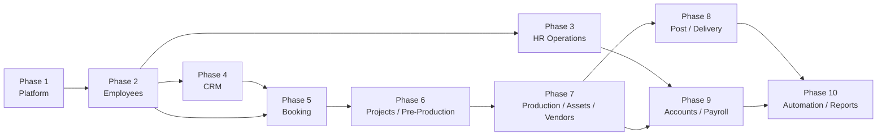

# DBS-Operations-OS Development Roadmap

## Table of Contents

- [Roadmap Principles](#roadmap-principles)
- [Phase 1: Platform Foundation](#phase-1-platform-foundation)
- [Phase 2: Organization and Employee Management](#phase-2-organization-and-employee-management)
- [Phase 3: HR Operations and Approvals](#phase-3-hr-operations-and-approvals)
- [Phase 4: CRM and Client Management](#phase-4-crm-and-client-management)
- [Phase 5: Shoot Booking and Calendar](#phase-5-shoot-booking-and-calendar)
- [Phase 6: Projects and Pre-Production](#phase-6-projects-and-pre-production)
- [Phase 7: Production, Assets, and Vendors](#phase-7-production-assets-and-vendors)
- [Phase 8: Post-Production and Delivery](#phase-8-post-production-and-delivery)
- [Phase 9: Accounts and Payroll](#phase-9-accounts-and-payroll)
- [Phase 10: Automation, Reports, and Enterprise Hardening](#phase-10-automation-reports-and-enterprise-hardening)
- [Development Order](#development-order)
- [Critical Milestones](#critical-milestones)
- [Recommended Build Sequence](#recommended-build-sequence)
- [Future Improvements](#future-improvements)

## Roadmap Principles

- Build upstream data foundations before dependent workflows.
- Complete each phase to an operational standard: validation, authorization, audit records, tests, documented APIs, and usable frontend states.
- Use the shared platform rather than recreating authentication, permissions, documents, notifications, or audit behavior in business modules.
- Keep Payroll, accounting close, heavy reporting, and broad automation behind proven operational data.

## Phase 1: Platform Foundation

| Item | Plan |
|---|---|
| Goal | Establish the secure, reusable platform layer for every future ERP module. |
| Business Value | Creates trusted access control, organization isolation, auditability, and a stable development standard. |
| Modules Included | Core Platform, Authentication, Users, Roles and Permissions, Settings, Audit foundation. |
| Database Tables | `organizations`, `organization_settings`, `users`, `sessions`, `roles`, `permissions`, `role_permissions`, `user_roles`, `documents`, `document_links`, `audit_logs`, `feature_flags`, `integration_connections`, `outbox_events`. |
| APIs | Authentication, logout/refresh lifecycle, current user, user administration, role/permission management, organization settings, audit-log retrieval. |
| Frontend Pages | Login, password recovery, first-admin setup, user directory, role management, settings shell, audit-log viewer. |
| Dependencies | None. |
| Estimated Complexity | High. |
| Deliverables | Versioned API conventions, validation/error standards, organization context, JWT security controls, permission matrix, audit infrastructure, test and CI foundation. |
| Completion Criteria | Only authorized users can access organization-scoped APIs; role and permission checks are enforced; sensitive actions are audited; API contracts and environment requirements are documented. |

## Phase 2: Organization and Employee Management

| Item | Plan |
|---|---|
| Goal | Build canonical workforce and organization master data that all employee-dependent modules reuse. |
| Business Value | Gives DBS one reliable employee directory, management hierarchy, employment lifecycle, and operational ownership model. |
| Modules Included | Organization structure, Employee Management, employee document linkage. |
| Database Tables | `departments`, `locations`, `designations`, `employment_types`, `employees`, `employee_profiles`, `employee_contacts`, `employee_employments`, `employee_assignments`, `employee_status_history`, employee-scoped `document_links`. |
| APIs | Employee directory/search, employee create/read/update, lifecycle actions, transfer/promotion/exit, assignment history, department/location/designation/employment-type management, employee document links. |
| Frontend Pages | Employee directory, employee profile, create/edit employee, employment history, department hierarchy, location/designation settings, employee exit console, my profile. |
| Dependencies | Phase 1 authentication, authorization, organization context, audit logs, and document service conventions. |
| Estimated Complexity | High. |
| Deliverables | Stable employee public identifiers, effective-dated assignments, manager hierarchy, permission-scoped employee access, lifecycle history, searchable directory. |
| Completion Criteria | An employee can be hired, activated, transferred, updated, exited, and retained historically without losing auditability; future modules can reference `employeeId` confidently. |

## Phase 3: HR Operations and Approvals

| Item | Plan |
|---|---|
| Goal | Add attendance, leave, approval workflows, and first production-grade notifications. |
| Business Value | Replaces manual employee time and leave processes while proving shared workflows and notification services. |
| Modules Included | Attendance, Leave, Approval foundation, Notifications. |
| Database Tables | `work_schedules`, `shifts`, `employee_shift_assignments`, `holiday_calendars`, `holidays`, `clock_events`, `attendance_records`, `attendance_correction_requests`, `leave_types`, `leave_policies`, `leave_policy_assignments`, `leave_balances`, `leave_ledger_entries`, `leave_requests`, `workflow_definitions`, `workflow_steps`, `approval_requests`, `approval_actions`, `notifications`, `notification_deliveries`, `notification_preferences`. |
| APIs | Clock events, attendance records, correction requests, leave balance/request APIs, approval inbox/actions, shift and holiday management, notifications. |
| Frontend Pages | Attendance dashboard, my attendance, leave calendar, leave request form, leave balance view, manager approval inbox, shift/holiday administration, notification center. |
| Dependencies | Phases 1 and 2. |
| Estimated Complexity | High. |
| Deliverables | Policy-aware leave balances, auditable attendance outcomes, reusable approval actions, in-app notification delivery, manager workflows. |
| Completion Criteria | Employees can request leave, managers can approve/reject it, balances remain ledger-backed, attendance records are traceable, and notifications are reliably delivered. |

## Phase 4: CRM and Client Management

| Item | Plan |
|---|---|
| Goal | Establish the commercial pipeline from lead capture to client, opportunity, and quotation. |
| Business Value | Centralizes revenue opportunities, client communication, follow-up, and commercial proposals. |
| Modules Included | CRM, Client Management, quotation management. |
| Database Tables | `lead_sources`, `leads`, `lead_activities`, `clients`, `client_contacts`, `client_addresses`, `pipelines`, `pipeline_stages`, `opportunities`, `opportunity_activities`, `quotations`, `quotation_line_items`. |
| APIs | Lead/client CRUD, pipeline movement, activities, contacts, opportunities, quotations, conversion of qualified lead to client. |
| Frontend Pages | CRM dashboard, lead list, pipeline board, lead detail, client directory, client profile, opportunity workspace, quotation builder. |
| Dependencies | Phase 1 platform services; Phase 2 employee ownership and assignment are recommended. |
| Estimated Complexity | Medium–High. |
| Deliverables | Qualified pipeline, client master data, proposal workflow, employee ownership, audit trail for commercial changes. |
| Completion Criteria | A lead can become a client, progress through an opportunity, receive a quotation, and be handed off to booking without duplicate client data. |

## Phase 5: Shoot Booking and Calendar

| Item | Plan |
|---|---|
| Goal | Convert accepted work into conflict-aware scheduled bookings. |
| Business Value | Creates a single operational calendar for studio services, crew allocation, locations, and client commitments. |
| Modules Included | Service Catalog, Shoot Booking, Calendar and Scheduling. |
| Database Tables | `service_catalog`, `service_packages`, `service_package_items`, `bookings`, `booking_line_items`, `booking_requirements`, `booking_status_history`, `booking_employee_assignments`, `booking_location_reservations`, `calendar_events`, `calendar_event_participants`. |
| APIs | Service/package management, booking CRUD, confirmation/reschedule/cancel, employee and location availability, calendar events, booking assignment APIs. |
| Frontend Pages | Booking calendar, booking list, create/edit booking, booking detail, service catalog, crew availability, location schedule. |
| Dependencies | Phases 2 and 4. Asset-reservation records and conflict workflows are introduced with Assets in Phase 7. |
| Estimated Complexity | High. |
| Deliverables | Client-linked bookings, status history, employee schedule visibility, location conflict checks, calendar integration boundary. |
| Completion Criteria | A confirmed quotation can create a booking, assigned employees are visible in the schedule, and booking changes are audited and notified. |

## Phase 6: Projects and Pre-Production

| Item | Plan |
|---|---|
| Goal | Turn scheduled bookings into executable projects and creative plans. |
| Business Value | Gives production teams shared visibility into responsibilities, creative requirements, and shoot readiness. |
| Modules Included | Project Management, Pre-Production. |
| Database Tables | `projects`, `project_members`, `project_status_history`, `project_tasks`, `task_assignees`, `task_dependencies`, `project_briefs`, `shot_lists`, `shot_list_items`, `moodboards`, `scripts`, `call_sheets`, `call_sheet_entries`, `project_checklists`. |
| APIs | Project CRUD, member allocation, task and dependency management, brief/shot-list/script management, call-sheet generation, project status APIs. |
| Frontend Pages | Project dashboard, project workspace, task board, brief editor, shot list, moodboard, script workspace, call sheet, project checklist. |
| Dependencies | Phases 2 and 5. |
| Estimated Complexity | High. |
| Deliverables | Booking-to-project conversion, project team allocation, task planning, creative planning artifacts, operational readiness checklist. |
| Completion Criteria | A booked job can become a project with assigned crew, actionable tasks, approved brief, shot list, and call sheet. |

## Phase 7: Production, Assets, and Vendors

| Item | Plan |
|---|---|
| Goal | Operate shoot days with controlled crew, equipment, locations, and vendor coordination. |
| Business Value | Reduces production risk, improves asset accountability, and creates a reliable record of execution. |
| Modules Included | Production, Assets, Inventory foundation, Vendors and Procurement foundation. |
| Database Tables | `production_days`, `production_day_assignments`, `production_locations`, `production_equipment_checkouts`, `production_notes`, `production_incidents`, `capture_batches`, `asset_categories`, `asset_models`, `assets`, `asset_status_history`, `asset_checkouts`, `asset_maintenance_records`, `warehouses`, `inventory_items`, `inventory_stock_levels`, `inventory_movements`, `vendors`, `vendor_contacts`, `vendor_services`, `vendor_rate_cards`, `vendor_contracts`, `vendor_bookings`, `booking_asset_reservations`, `purchase_requests`, `purchase_orders`, `purchase_order_line_items`. |
| APIs | Production-day APIs, crew call times, equipment checkout/return, asset registry and maintenance, inventory movements, vendor CRUD and booking. |
| Frontend Pages | Production dashboard, shoot-day board, crew call sheet view, equipment checkout, asset directory/detail, maintenance schedule, vendor directory/profile. |
| Dependencies | Phases 2, 5, and 6. |
| Estimated Complexity | High. |
| Deliverables | Crew/asset/vendor visibility for each production day, asset custody records, incident capture, maintenance tracking. |
| Completion Criteria | A production day can assign staff, reserve/check out equipment, coordinate vendors, record incidents, and retain operational history. |

## Phase 8: Post-Production and Delivery

| Item | Plan |
|---|---|
| Goal | Manage media assets from ingestion through editing, review, approval, secure delivery, and archival. |
| Business Value | Creates traceable creative output, faster review cycles, and a professional client-delivery process. |
| Modules Included | File and Asset Management, Post-Production, Delivery. |
| Database Tables | `media_assets`, `media_asset_versions`, `media_collections`, `media_collection_items`, `edit_jobs`, `review_cycles`, `review_comments`, `asset_approvals`, `render_jobs`, `archive_records`, `deliverables`, `delivery_packages`, `delivery_package_items`, `delivery_links`, `delivery_recipients`, `delivery_events`, `delivery_acceptances`. |
| APIs | Upload/ingest metadata, media/version APIs, edit-job assignment, review comments, approval actions, rendering records, secure delivery links, delivery tracking. |
| Frontend Pages | Media library, project asset browser, edit queue, review/proofing screen, approval queue, delivery builder, client delivery portal. |
| Dependencies | Phases 1, 6, and 7; object storage must be operational. |
| Estimated Complexity | Very High. |
| Deliverables | Versioned media lifecycle, role-controlled reviews, client-safe delivery links, retention and archive metadata. |
| Completion Criteria | Media can move from capture to approved deliverable with preserved versions, review history, access controls, and measurable delivery events. |

## Phase 9: Accounts and Payroll

| Item | Plan |
|---|---|
| Goal | Add financial control, accounting records, procurement linkage, and payroll integration. |
| Business Value | Connects operational activity to billing, payments, cost control, vendor obligations, and workforce compensation. |
| Modules Included | Accounts, expense/procurement controls, Payroll. |
| Database Tables | `currencies`, `tax_rates`, `fiscal_years`, `accounting_periods`, `chart_of_accounts`, `cost_centers`, `journal_entries`, `journal_entry_lines`, `invoices`, `invoice_line_items`, `payments`, `payment_allocations`, `expenses`, `expense_line_items`, `budgets`, `budget_lines`, `vendor_bills`, `salary_components`, `salary_structures`, `employee_compensations`, `payroll_periods`, `payroll_runs`, `payslips`, `payslip_line_items`. This phase consumes the procurement tables delivered in Phase 7. |
| APIs | Invoices, payments, expenses, purchase requests/orders, vendor bills, journals, account periods, budgets, payroll runs, payslips. |
| Frontend Pages | Finance dashboard, invoice list/detail, payment recording, expense claims, procurement queue, chart of accounts, budgets, payroll dashboard, payslip view. |
| Dependencies | Phases 2–7; Payroll additionally depends on stable attendance, leave, and approval rules from Phase 3. |
| Estimated Complexity | Very High. |
| Deliverables | Double-entry accounting foundation, receivables, expenses, procurement linkage, controlled payroll runs, financial auditability. |
| Completion Criteria | Financial records are balanced, periods can be controlled, invoices can be paid and reconciled, and payroll creates approved immutable records and accounting handoffs. |

## Phase 10: Automation, Reports, and Enterprise Hardening

| Item | Plan |
|---|---|
| Goal | Automate cross-module workflows, deliver governed analytics, integrate external systems, and harden production operations. |
| Business Value | Reduces manual coordination, gives leadership measurable insight, and makes the ERP dependable at organization scale. |
| Modules Included | Automation, WhatsApp Automation, Reports and Analytics, integrations, operational hardening. |
| Database Tables | `automation_workflows`, `automation_triggers`, `automation_steps`, `automation_executions`, `automation_step_executions`, `webhook_endpoints`, `webhook_deliveries`, `whatsapp_templates`, `whatsapp_messages`, `conversation_threads`, `dashboard_definitions`, `saved_reports`, `report_schedules`, `report_runs`, `report_exports`, `metric_definitions`. |
| APIs | Automation workflow APIs, execution history, webhook APIs, WhatsApp messaging/templates, integration configuration, dashboards, saved reports, scheduled exports. |
| Frontend Pages | Automation builder, workflow execution history, integration settings, WhatsApp templates/conversations, executive dashboard, report builder, scheduled reports. |
| Dependencies | Phases 1–9 and reliable outbox events. |
| Estimated Complexity | Very High. |
| Deliverables | Event-driven automation, scheduled workflows, reporting governance, integration observability, backup/monitoring/security hardening. |
| Completion Criteria | Business events reliably trigger configured automations, reports are permission-scoped and schedulable, integrations are observable, and production operational standards are documented and monitored. |

## Development Order

## Critical Milestones

| Milestone | Required outcome |
|---|---|
| Secure platform ready | Organization-scoped authentication, roles, permissions, audit logs, and versioned APIs work consistently. |
| Workforce foundation ready | Employee lifecycle and organization structure are stable enough for all modules to reference `employeeId`. |
| HR operations ready | Attendance, leave, approvals, and notifications work with reliable historical records. |
| Commercial-to-booking flow ready | A lead can become a client, quotation, and scheduled booking without duplicate data. |
| Production lifecycle ready | A booking can become a project, production day, media workflow, and delivered client output. |
| Financial control ready | Invoices, expenses, procurement, accounting, and payroll handoffs are auditable and controlled. |
| Enterprise-ready operations | Automation, reporting, integrations, monitoring, backup, and security operations are mature. |

## Recommended Build Sequence

1. Complete Phase 1 before introducing business-domain features.
2. Build Phase 2 as the first full business module; stabilize employee IDs, history, and permission scopes.
3. Build Phase 3 before Payroll or complex production scheduling.
4. Build CRM and Booking as one commercial-to-operations chain across Phases 4 and 5.
5. Build Projects and Pre-Production before Production; a shoot should not execute without an approved operational plan.
6. Build physical Assets and Vendors together with Production because reservations, checkout, and external suppliers are shoot-day concerns.
7. Build Post-Production and Delivery only after object storage, file permissions, and project ownership are dependable.
8. Build Accounts and Payroll after the operational sources they depend on have proven data quality.
9. Build broad Automation and reporting after stable events, source data, and ownership boundaries exist.

## Future Improvements

- Multi-organization groups and enterprise administration.
- Single sign-on and external identity providers.
- Mobile workflows for attendance, production days, assets, and approvals.
- Barcode/QR asset management.
- Calendar-provider synchronization.
- Client self-service and vendor portals.
- AI-assisted media tagging, document extraction, scheduling, and operational insights.
- Reporting read models or a warehouse for large analytical workloads.
- External accounting, payroll, payment, attendance-device, and marketing-platform integrations.
- Disaster recovery validation, data-retention controls, and compliance certifications as operational scale requires them.
